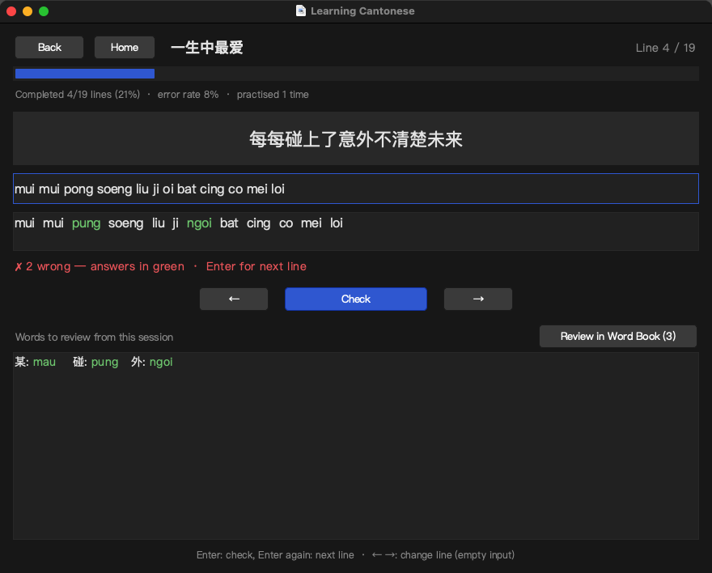
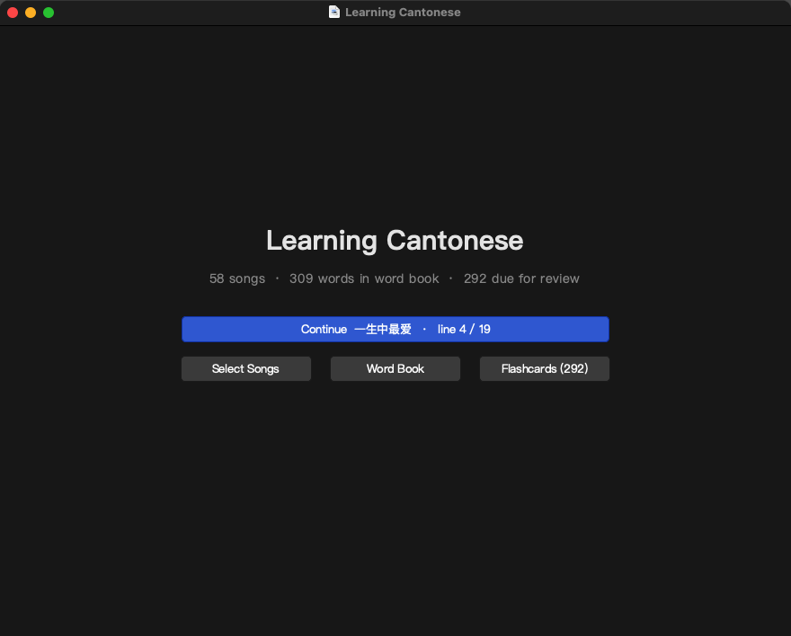
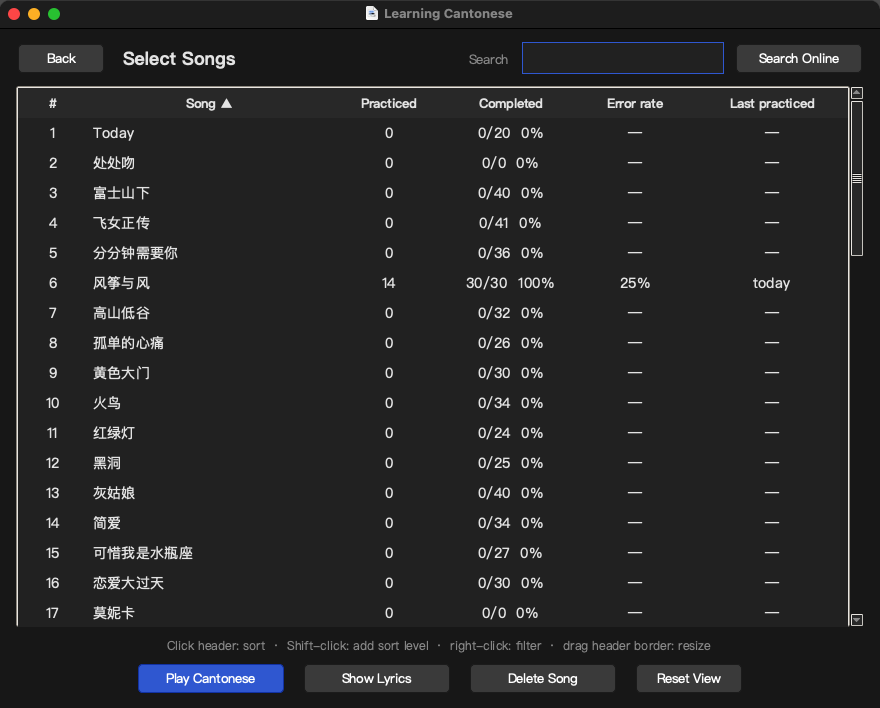
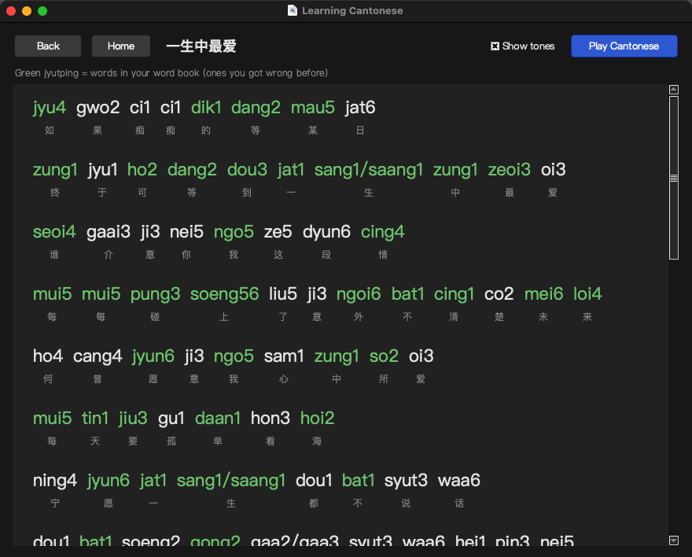
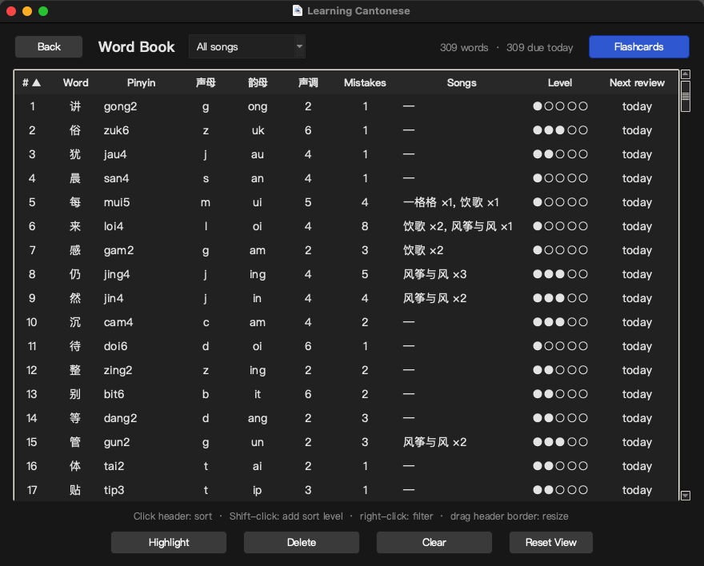
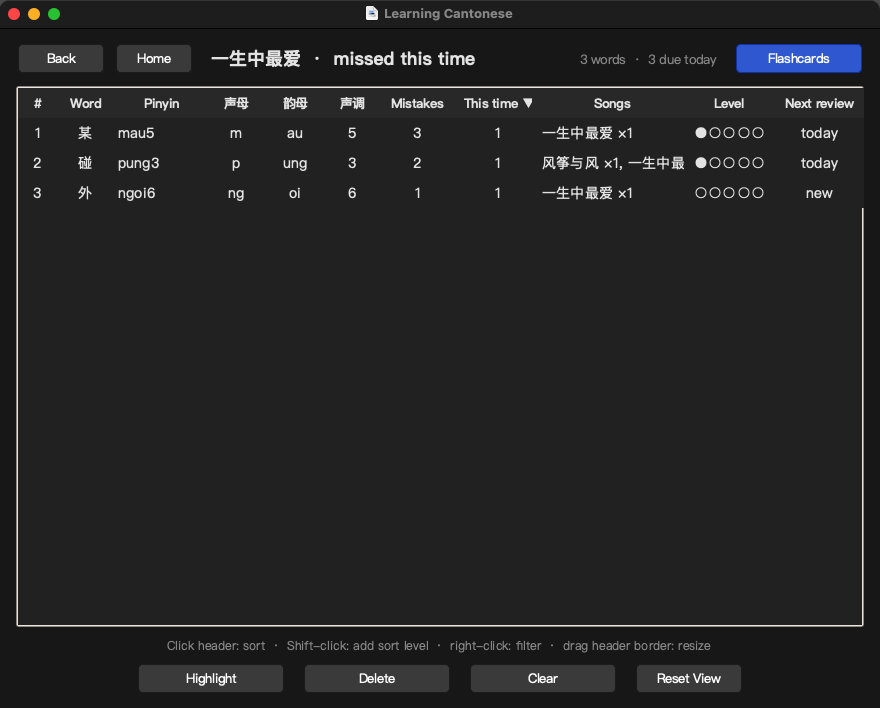
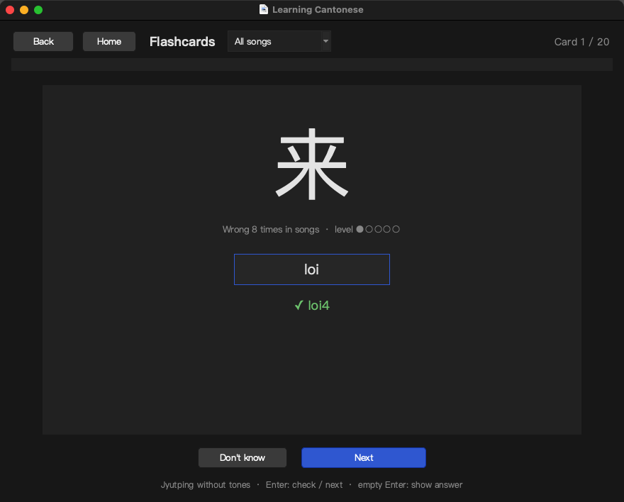
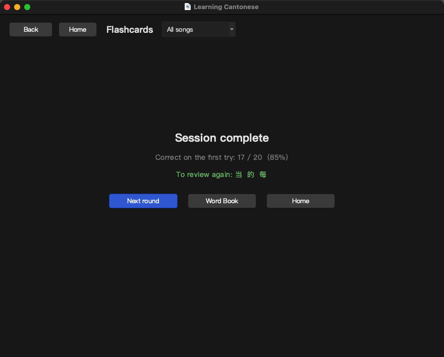

<p align="center">
  
</p>

<h1 align="center">Learning Cantonese · 粤语歌学习</h1>

<p align="center">
  <b>Learn Jyutping with the Cantonese songs you love.</b><br>
  Type the Jyutping of each lyric line, let your mistakes build a word book, then review them with spaced-repetition flashcards.
</p>

<p align="center">
  <a href="https://github.com/XimeCraft/CantoneseSongsLearner/releases/latest/download/LearningCantonese.dmg">
    
  </a>
</p>

<p align="center">
  
  
  
  
</p>

<p align="center"><a href="README.md">中文</a> · English</p>



## Why learn with songs

- **The melody is already in your head.** You can hum these songs already. What's missing is matching each character to its sound and spelling. Typing Jyutping along with the lyrics makes that stick, and it never gets boring.
- **Instant feedback.** Press Enter after each line and every wrong or missing syllable is shown with the correct reading in green.
- **Mistakes collect themselves.** Every character you get wrong goes into the word book with the song it came from and how often you missed it. Filter by initial, final or tone to work on your weak spots.
- **Review on a schedule.** Flashcards use Leitner boxes to space out reviews. The home page tells you how many words are due today.
- **58 classic Cantonese songs built in**, plus an index of 7,000+ songs you can search and download lyrics from.
- **Your data stays on your Mac.** No account, no sync. The interface follows the system's light or dark mode.

## Before you start

The app uses **Jyutping**, the Cantonese romanisation scheme of the Linguistic Society of Hong Kong. While practising you type only the initial and final, never the tone (粤 → `jyut`). If Jyutping is new to you, spend 20 minutes on an introduction first:

- YouTube: https://www.youtube.com/watch?v=y0D7j03GWXc&t=14s
- Bilibili (if YouTube is unavailable): https://www.bilibili.com/video/BV1kU4y1r7qR/

Two handy references: the [Jyutping chart at jyutping.org](https://jyutping.org/) for initials and finals, and the [words.hk dictionary](https://words.hk/) for readings and meanings.

## Install

Apple Silicon (M-series) Macs only. On an Intel Mac, [run from source](#developers).

**[Download LearningCantonese.dmg](https://github.com/XimeCraft/CantoneseSongsLearner/releases/latest/download/LearningCantonese.dmg)**

1. Open the DMG and drag Learning Cantonese to Applications.
2. Open the app. It isn't notarised by Apple, so macOS blocks it: click "Done" (not "Move to Trash").
3. Go to System Settings → Privacy & Security, scroll to Security, click "Open Anyway" next to Learning Cantonese and enter your password. It opens normally from then on.

Or do it in one line in Terminal:

```bash
xattr -dr com.apple.quarantine "/Applications/Learning Cantonese.app"
```

## Three minutes to get going

1. Open the app, click **Select Songs** and double-click a song you can sing.
2. Read the lyric line and type the Jyutping of each character, separated by spaces, without tones. Press **Enter**.
3. Correct syllables stay white; wrong or missing ones show the correct reading in green. Press **Enter** again for the next line.
4. At the end of the song (or any time), click **Review in Word Book** to see what you missed, then **Flashcards** to drill them straight away.
5. From then on, the home page shows how many words are due each day. Click **Flashcards** to review, or **Continue** to pick up the last song where you left off.

## Manual

### Home



- Three numbers: songs, words in the word book, and words due for review today.
- **Continue** reopens the last song at the line you stopped on.
- The **Main** menu in the menu bar jumps to any page.

### Select Songs



- One row per song: how often you practised it, how many lines you completed, your error rate and when you last practised.
- **Search box**: filters the local songs by name.
- **Search Online**: type the full song name in the search box, then click this button to look it up in the built-in index of 7,000+ Cantonese songs (Eason Chan, Leslie Cheung, Miriam Yeung, Hacken Lee and many more). Songs with the same title list each singer; pick one and click **Download Lyric**. The lyrics (from feitsui.com, 翡翠粤语歌词网) appear in the list as soon as they're downloaded.
- **Play Cantonese** (or double-click / Enter) starts practising; **Show Lyrics** shows the whole song with Jyutping; **Delete Song** removes the song and its statistics.

Table controls (the word book works the same way):

| Action | Effect |
|---|---|
| Click a header | Sort by that column; click again to reverse |
| Shift + click a header | Add a secondary sort level |
| Right-click a header | Filter by value (multi-select, searchable) |
| Drag a header border | Resize the column |
| Reset View | Back to the default sort, filters and widths |

### Practice


- The top shows the song's progress bar and statistics: lines completed, error rate, number of sessions.
- **Input rules**: one Jyutping syllable per character, separated by spaces, **no tones**, any case. Characters with several readings (written `sang1/saang1` in the lyrics) accept either one.
- **Enter** checks the line. In the result, white syllables are correct and green ones are the correct reading of what you got wrong or left out.
- **Enter again** moves to the next line. With the input box empty, **← →** jump between lines. Your position is saved, so Continue on the home page brings you back.
- Every wrong character goes into the word book and its mistake count goes up. If it had already climbed to a high flashcard level, it drops back to level 1 and is due today.
- The words missed in this session are listed below. **Review in Word Book (n)** opens a word book view with just those words, from where you can start flashcards.
- Reaching the last line shows 🎉; **Back to line 1** starts the song over.

### Lyrics



- Jyutping with tones above every character; **Show tones** switches the tone numbers off.
- **Green** syllables are characters in your word book (ones you got wrong before), so you revisit them as you read.
- **Play Cantonese** starts practising this song.

### Word Book



- One row per missed character: Jyutping (tones taken from the lyrics), initial (声母), final (韵母), tone (声调), mistake count, which songs it was missed in and how often, flashcard level (●●○○○) and the next review date.
- The dropdown at the top left limits the table to the words missed in one song, most missed first. **Flashcards** then reviews only those.
- Right-click filtering is handy here: show only characters with the final `eoi`, or everything in tone 6, and drill them together.
- **Highlight** marks a word as important (it comes up first in flashcards); **Delete** removes the selected word; **Clear** empties the whole word book.
- Opening the word book from Review in Word Book after a song shows the "missed this time" view, with an extra **This time** column:



### Flashcards



- A character is shown; type its Jyutping (no tones) and press **Enter**. A correct answer shows the reading with tones.
- Enter on an empty box, or **Don't know**, reveals the answer (counted as wrong).
- Up to 20 cards per round, only words due today, with highlighted words and low levels first. A card you get wrong comes back later in the same round until you get it right.
- The end of a round shows your first-try accuracy and the words to review again; **Next round** continues.
- When nothing is due, the page shows the next review date, and **Review all words anyway** lets you go through everything.



**How is the schedule worked out?** With Leitner boxes: each word has a level from 1 to 5. A correct answer moves it up one level, and the next review comes 1, 2, 4, 7 or 15 days later. A wrong answer sends it back to level 1, due today. Only the first answer in a round counts. Getting the character wrong again in a song also sends it back to level 1.

### Keyboard shortcuts

| Page | Key | Action |
|---|---|---|
| Practice | Enter | Check; press again for the next line |
| Practice | ← / → | Previous / next line (with an empty input box) |
| Flashcards | Enter | Check; press again for the next card; empty input reveals the answer |
| Select Songs | Double-click / Enter | Start practising |
| Tables | Click / Shift + click / right-click a header | Sort / multi-level sort / filter |
| Filter popup | Enter / Esc | Apply / close |

### Adding your own songs

Search Online needs the exact song title. For anything else, add the song by hand: create `<song name>.txt` in the songs folder with a line of Chinese lyrics followed by a line of Jyutping with tones (space-separated), alternating all the way down. Blank lines and lines containing `https` are ignored; alternative readings of a character are joined with `/`.

```
如果痴痴的等某日
jyu4 gwo2 ci1 ci1 dik1 dang2 mau5 jat6
终于可等到一生中最爱
zung1 jyu1 ho2 dang2 dou3 jat1 sang1/saang1 zung1 zeoi3 oi3
```

Where the songs folder is:

- App installed from the DMG: `~/Library/Application Support/Learning Cantonese/data/songs/`
- Running from source: `data/songs/` in the project

Reopen Select Songs and the song is there. Look up Jyutping at [words.hk](https://words.hk/) or [feitsui.com](https://www.feitsui.com/).

### Your data

Everything stays on your Mac. There is no account and nothing is uploaded:

| File | Contents |
|---|---|
| `data/songs/*.txt` | Lyrics |
| `data/new words.json` | Word book: character, Jyutping, mistake count, highlight flag |
| `data/progress.json` | Per-song practice statistics, each word's flashcard level and review date |

The DMG app keeps them in `~/Library/Application Support/Learning Cantonese/`; running from source uses the project's `data/`. To back up, copy that folder. Updating the app keeps your data: bundled songs are only added when missing, so lyrics you edited are never overwritten. If something goes wrong, check the log at `~/Library/Logs/LearningCantonese.log`.

## FAQ

**macOS says the app is damaged or can't verify the developer.** The app isn't signed by Apple. Use "Open Anyway" in Privacy & Security as in step 3 of the install guide, or run `xattr -dr com.apple.quarantine "/Applications/Learning Cantonese.app"`.

**Does it run on an Intel Mac?** The DMG is Apple Silicon only. On an Intel Mac, run from source as described under Developers.

**Why is my answer wrong when I type the tone?** Practice and flashcards compare only initials and finals; leave the tone numbers out. The lyrics page and the check results show the readings with tones for reference.

**Search Online finds nothing.** It needs the full song title, without the singer. Songs missing from the index can be added by hand as described above.

**How do I start over?** Delete Song in Select Songs clears that song's records (bundled songs come back on the next launch, others can be downloaded again); Clear in the Word Book removes the word book and all flashcard progress.

## Developers

<details>
<summary>Run from source, build, helper scripts</summary>

Requires [uv](https://docs.astral.sh/uv/).

```bash
uv venv --python 3.12 .venv
uv pip install --python .venv/bin/python -r requirements.txt
# uv's standalone Python can't locate Tcl/Tk from inside a venv; link them in:
PY_LIB="$(.venv/bin/python -c 'import sys; print(sys.base_prefix)')/lib"
ln -s "$PY_LIB/tcl8.6" "$PY_LIB/tk8.6" .venv/lib/

.venv/bin/python app.py
```

Scripts:

| Command | What it does |
|---|---|
| `./make_app.sh` | Creates `~/Applications/Learning Cantonese.app`, which runs `app.py` from this folder: code changes take effect immediately and data stays in `data/` |
| `./make_dmg.sh` | Builds a standalone app with PyInstaller into `dist/LearningCantonese.dmg` (songs only, never your word book or progress) |
| `uv run --python 3.12 --with-requirements requirements.txt --with pyobjc-framework-Cocoa tools/screenshots.py` | Regenerates the README screenshots in `docs/screenshots/`. Runs on a temporary copy of `data/`, so your data is untouched |
| `uv run --with pillow python tools/make_icon.py assets` | Redraws the app icon (icns / ico / jpg) |
| `.venv/bin/python tools/backfill_song_misses.py` | One-off: attributes early word book mistakes to songs from the git history |

Publishing a release:

```bash
./make_dmg.sh
gh release create v1.1 dist/LearningCantonese.dmg --title "v1.1" --notes "What changed"
```

Project layout:

```
app.py               UI: home, song table, practice, lyrics, word book, flashcards
progress.py          Practice statistics and Leitner state for flashcards (data/progress.json)
learnCantonese.py    Reads lyrics, reads/writes the word book, downloads lyrics
jyutping.py          Splits Jyutping syllables into initial and final, LSHK table order
theme.py             Light/dark palette, fonts, buttons
utils.py             Window centering, menu bar
packaged_app.py      Entry point of the DMG app: points the data folder at ~/Library/Application Support
data/songs/*.txt     Lyrics (Chinese + Jyutping with tones)
data/songs info.csv  Song index used by Search Online
```

</details>
