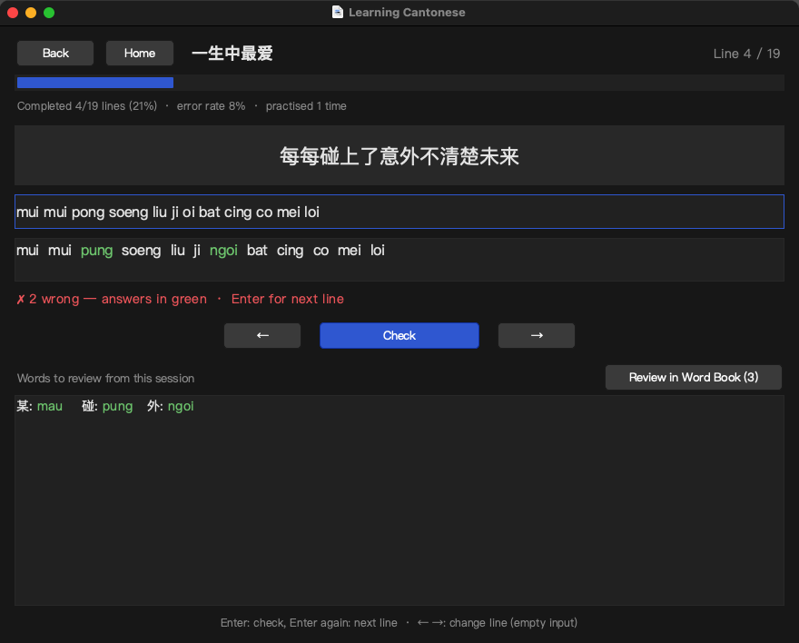
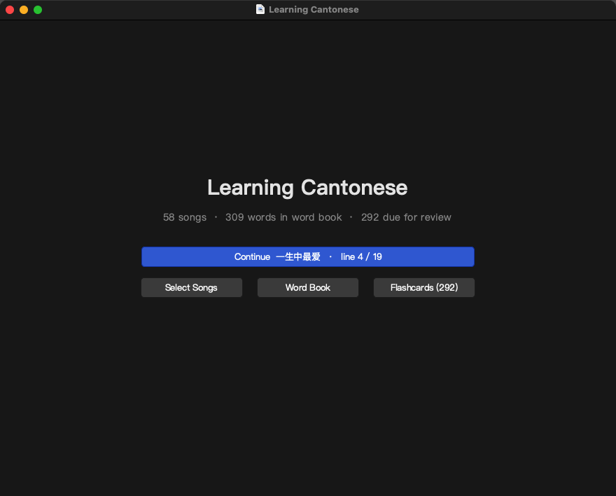
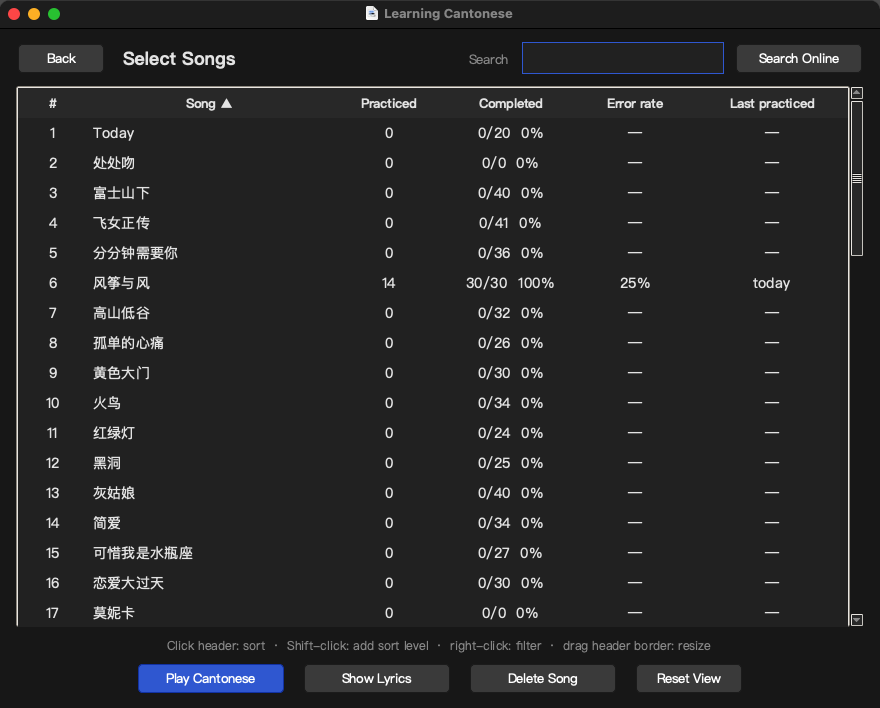
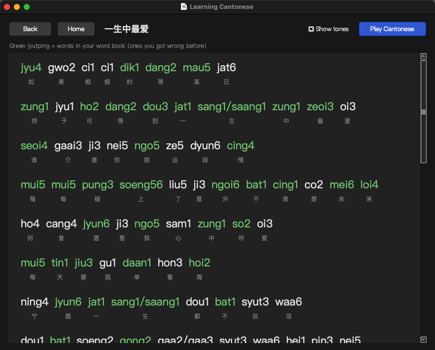
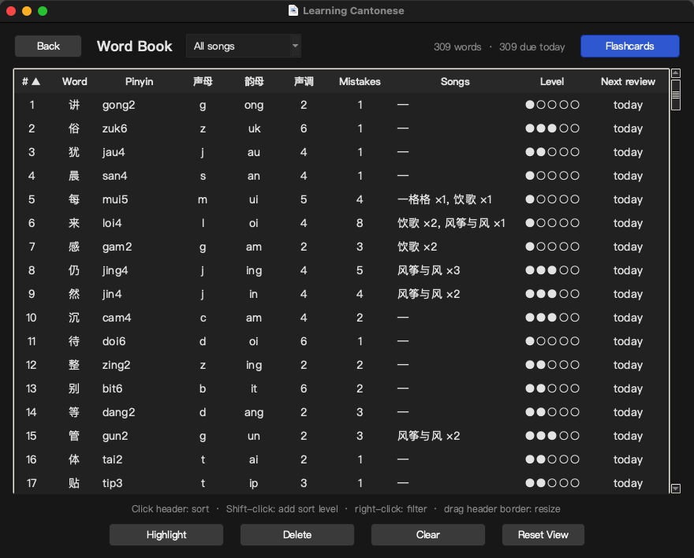
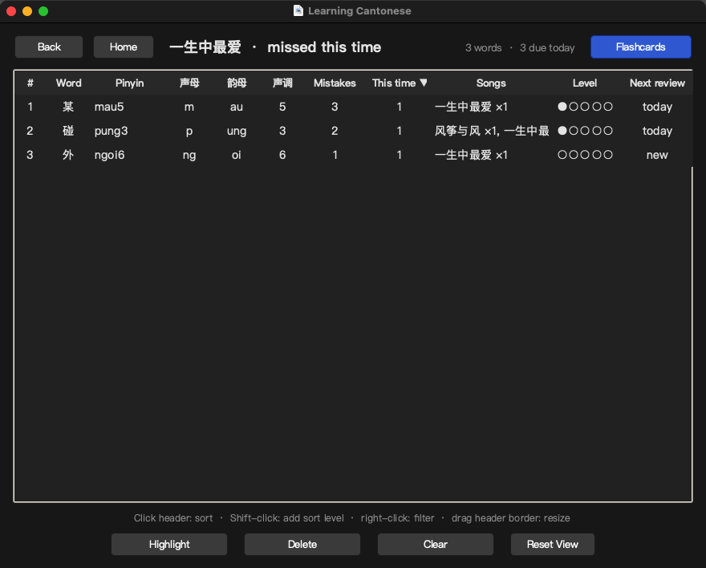
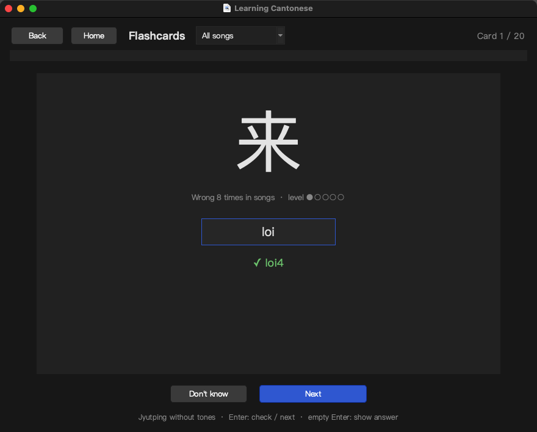
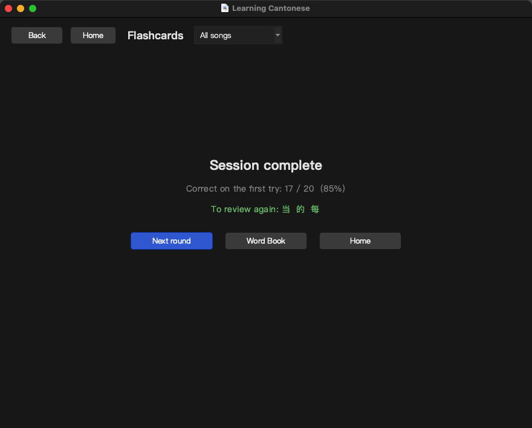

<p align="center">
  
</p>

<h1 align="center">Learning Cantonese · 粤语歌学习</h1>

<p align="center">
  <b>用你最爱的粤语歌练粤拼。</b><br>
  看着歌词一行行打出粤拼，打错的字自动进生词本，再用闪卡按记忆曲线复习。
</p>

<p align="center">
  <a href="https://github.com/XimeCraft/CantoneseSongsLearner/releases/latest/download/LearningCantonese.dmg">
    
  </a>
  <a href="https://github.com/XimeCraft/CantoneseSongsLearner/releases/latest/download/LearningCantonese-Intel.dmg">
    
  </a>
</p>

<p align="center">
  
  
  
  
</p>

<p align="center">中文 · <a href="README.en.md">English</a></p>



## 为什么用歌来学

- **旋律早就在脑子里。** 粤语歌你本来就会哼，缺的只是把每个字的读音和拼写对上号。跟着歌词打粤拼，记得牢，也不枯燥。
- **当场知道错在哪。** 每行歌词按回车检查，打错或漏打的字立刻用绿色标出正确读音。
- **错题自动沉淀。** 打错的字自动进生词本，记着它来自哪首歌、错过几次，还能按声母、韵母、声调筛选，专攻薄弱环节。
- **按记忆曲线复习。** 闪卡用 Leitner 盒子安排复习间隔，首页直接告诉你今天有多少字到期。
- **内置 58 首经典粤语歌**，还能在 7000 多首歌的索引里按歌名搜索、下载歌词。
- **数据只在你的 Mac 上。** 没有账号，不联网同步。界面自动跟随系统的深浅色模式。

## 开始之前

本应用使用 **粤拼（Jyutping）**，香港语言学学会制定的粤语拼音方案。练习时只需要打声母和韵母，不用打声调（例如 粤 → `jyut`）。如果你还不了解粤拼，先花 20 分钟看一个入门视频：

- YouTube：https://www.youtube.com/watch?v=y0D7j03GWXc&t=14s
- Bilibili（无法访问 YouTube 时）：https://www.bilibili.com/video/BV1kU4y1r7qR/

顺手收藏两个工具：[粤拼方案表 jyutping.org](https://jyutping.org/) 查声母韵母，[粵典 words.hk](https://words.hk/) 查单字读音和释义。

## 安装

按你的 Mac 芯片选择下载（点屏幕左上角的苹果菜单 → 关于本机，看"芯片"或"处理器"一栏）：

| 你的 Mac | 下载 |
|---|---|
| Apple 芯片（M1、M2、M3、M4…） | **[LearningCantonese.dmg](https://github.com/XimeCraft/CantoneseSongsLearner/releases/latest/download/LearningCantonese.dmg)** |
| Intel 芯片（处理器一栏写着 Intel），macOS 10.15 及以上 | **[LearningCantonese-Intel.dmg](https://github.com/XimeCraft/CantoneseSongsLearner/releases/latest/download/LearningCantonese-Intel.dmg)** |

Intel 版也能在 Apple 芯片的 Mac 上通过 Rosetta 运行，但会慢一些，M 系列请下载第一个。

1. 打开 DMG，把 Learning Cantonese 拖到 Applications。
2. 双击打开。应用没有经过 Apple 公证，macOS 会拦下，点"完成"（不要点"移到废纸篓"）。
3. 打开"系统设置 → 隐私与安全性"，拉到"安全性"一栏，点 Learning Cantonese 旁边的"仍要打开"，输入开机密码。之后就能正常打开了。

也可以在终端里一行解决：

```bash
xattr -dr com.apple.quarantine "/Applications/Learning Cantonese.app"
```

## 三分钟上手

1. 打开应用，点 **Select Songs**，双击一首你会唱的歌。
2. 看着歌词，把每个字的粤拼打出来，用空格隔开，不打声调，按 **Enter**。
3. 对的字正常显示，错的或漏打的字用绿色标出正确读音。再按 **Enter** 进入下一行。
4. 唱完整首（或随时），点 **Review in Word Book** 看这次错的字，再点 **Flashcards** 马上复习一遍。
5. 之后每天打开应用，首页会显示今天有多少字到期，点 **Flashcards** 复习；点 **Continue** 接着上次的歌练。

## 功能手册

### 首页



- 三个数字：歌曲数、生词本字数、今天到期要复习的字数。
- **Continue**：接着上次练的歌，从停下的那一行继续。
- 菜单栏的 **Main** 菜单可以随时跳到任意页面。

### 选歌 Select Songs



- 每首歌一行：练过几次（Practiced）、完成了多少行（Completed）、错误率（Error rate）、上次练习时间（Last practiced）。
- **搜索框**：按歌名过滤本地歌曲。
- **Search Online**：在搜索框输入完整歌名再点这个按钮，会在内置的歌名索引（7000 多首粤语歌：陈奕迅、张国荣、杨千嬅、李克勤……）里查找。同名歌会列出不同歌手，选一个点 **Download Lyric**，歌词（来自翡翠粤语歌词网）下载后直接出现在列表里。
- **Play Cantonese**（或双击、Enter）开始练习；**Show Lyrics** 看整首带粤拼的歌词；**Delete Song** 删掉歌曲和它的练习记录。

表格操作（生词本的表格同样适用）：

| 操作 | 效果 |
|---|---|
| 点表头 | 按这一列排序，再点切换升降序 |
| Shift + 点表头 | 加一个次级排序 |
| 右键表头 | 按值筛选（可多选、可搜索） |
| 拖动表头边线 | 调整列宽 |
| Reset View | 恢复默认排序、筛选和列宽 |

### 练习 Practice


- 顶部是这首歌的进度条和统计：完成行数、错误率、练习次数。
- **输入规则**：一个字一个粤拼，用空格隔开，**不打声调**，大小写不限。有多个读音的字（歌词里写成 `sang1/saang1`）打任意一个都算对。
- **Enter**：检查。结果行里白色的是打对的，绿色的是正确读音（你打错或漏掉的）。
- **再按 Enter**：下一行。输入框为空时按 **← →** 可以前后跳行。进度自动保存，下次从首页 Continue 继续。
- 打错的字自动进生词本，错误次数 +1。如果这个字在闪卡里已经升到高等级，会被打回第 1 级、今天重新复习。
- 下方列出本次练习错过的字。**Review in Word Book (n)** 打开只包含这些字的生词本视图，从那里可以直接开闪卡。
- 到最后一行会出现 🎉，**Back to line 1** 从头再来一遍。

### 歌词 Lyrics



- 每个字上方是带声调的粤拼，**Show tones** 可以关掉声调。
- **绿色**的是生词本里的字（你以前错过的），看歌词时顺便再认一遍。
- **Play Cantonese** 直接开始练这首歌。

### 生词本 Word Book



- 每个错过的字一行：粤拼（声调取自歌词）、声母、韵母、声调、错误次数（Mistakes）、在哪些歌里错过几次（Songs）、闪卡等级（Level，●●○○○）、下次复习时间（Next review）。
- 左上角的下拉框可以只看某一首歌里错的字，按错误次数排序。这时 **Flashcards** 也只复习这些字。
- 右键表头筛选很好用：比如只看韵母是 `eoi` 的字，或者所有第 6 声的字，集中攻克。
- **Highlight** 标记重点字（闪卡里优先出现）；**Delete** 删除选中的字；**Clear** 清空整个生词本。
- 练完一首歌点 Review in Word Book 进入的是 "missed this time" 视图，多一列 **This time**（这次错了几遍）：



### 闪卡 Flashcards



- 显示一个字，打它的粤拼（不打声调），**Enter** 检查。答对会显示带声调的读音。
- 输入为空时按 Enter，或点 **Don't know**，直接看答案（算答错）。
- 每轮最多 20 张，只出今天到期的字，重点字和等级低的字排在前面。答错的字这一轮稍后会再出现，直到答对为止。
- 一轮结束显示首次答对率和需要再复习的字，**Next round** 继续下一轮。
- 没有到期的字时会提示下次复习的日期，也可以 **Review all words anyway** 把所有字过一遍。



**复习间隔是怎么算的？** 用的是 Leitner 盒子：每个字有 1 到 5 级。答对升一级，下次复习分别在 1、2、4、7、15 天后；答错回到第 1 级，今天再来。一轮里只有第一次作答算数。在歌里再次打错也会把这个字打回第 1 级。

### 快捷键

| 页面 | 按键 | 作用 |
|---|---|---|
| 练习 | Enter | 检查；再按一次到下一行 |
| 练习 | ← / → | 上一行 / 下一行（输入框为空时） |
| 闪卡 | Enter | 检查；再按一次到下一张；输入为空时显示答案 |
| 选歌 | 双击 / Enter | 开始练习 |
| 表格 | 点 / Shift + 点 / 右键表头 | 排序 / 多级排序 / 筛选 |
| 筛选弹窗 | Enter / Esc | 应用 / 关闭 |

### 添加自己的歌

Search Online 只能按完整歌名精确匹配。找不到的歌可以手动添加：在歌曲文件夹里新建 `歌名.txt`，一行中文歌词、一行对应的带声调粤拼（空格分开），交替写下去。空行和含 `https` 的行会被忽略，一个字有多个读音用 `/` 连起来。

```
如果痴痴的等某日
jyu4 gwo2 ci1 ci1 dik1 dang2 mau5 jat6
终于可等到一生中最爱
zung1 jyu1 ho2 dang2 dou3 jat1 sang1/saang1 zung1 zeoi3 oi3
```

歌曲文件夹的位置：

- DMG 安装的应用：`~/Library/Application Support/Learning Cantonese/data/songs/`
- 从源码运行：项目里的 `data/songs/`

保存后重新进入 Select Songs 就能看到。粤拼可以在 [粵典](https://words.hk/) 或 [翡翠粤语歌词网](https://www.feitsui.com/) 查。

### 你的数据

所有数据都在本机，没有账号，不上传：

| 文件 | 内容 |
|---|---|
| `data/songs/*.txt` | 歌词 |
| `data/new words.json` | 生词本：字、粤拼、错误次数、是否高亮 |
| `data/progress.json` | 每首歌的练习统计，每个字的闪卡等级和复习日期 |

DMG 版放在 `~/Library/Application Support/Learning Cantonese/`，源码运行放在项目的 `data/`。备份就是复制这个文件夹。升级到新版本时数据会保留，内置歌曲只在缺失时才补上，不会覆盖你改过的歌词。出问题时可以看日志 `~/Library/Logs/LearningCantonese.log`。

## 常见问题

**打开时提示"已损坏，无法打开"或"无法验证开发者"？** 应用没有 Apple 签名。按安装第 3 步在"隐私与安全性"里点"仍要打开"，或者运行 `xattr -dr com.apple.quarantine "/Applications/Learning Cantonese.app"`。

**Intel Mac 能用吗？** 能，下载 Intel 版 DMG 即可，需要 macOS 10.15 Catalina 或更新。

**打了声调为什么算错？** 练习和闪卡都只比对声母和韵母，不要打数字声调。歌词页和检查结果里会显示带声调的读音供参考。

**Search Online 搜不到？** 需要输入完整歌名（不含歌手）。索引里没有的歌可以按"添加自己的歌"手动加。

**想重新开始？** Select Songs 里 Delete Song 会清掉那首歌的记录（内置歌曲下次启动会自动恢复，其他歌可以重新下载）；Word Book 里 Clear 清空生词本和闪卡进度。

## 开发者

<details>
<summary>从源码运行、打包、工具脚本</summary>

需要 [uv](https://docs.astral.sh/uv/)。

```bash
uv venv --python 3.12 .venv
uv pip install --python .venv/bin/python -r requirements.txt
# uv 的独立 Python 在 venv 里找不到 Tcl/Tk，链接进去：
PY_LIB="$(.venv/bin/python -c 'import sys; print(sys.base_prefix)')/lib"
ln -s "$PY_LIB/tcl8.6" "$PY_LIB/tk8.6" .venv/lib/

.venv/bin/python app.py
```

脚本：

| 命令 | 作用 |
|---|---|
| `./make_app.sh` | 在 `~/Applications` 生成 Learning Cantonese.app，直接运行本目录的 `app.py`：改代码即时生效，数据仍在 `data/` |
| `./make_dmg.sh` | 用 PyInstaller 打包成独立应用，生成 Apple 芯片版 `dist/LearningCantonese.dmg`（只带歌词，不带你的生词本和进度） |
| `./make_dmg.sh intel` | 在 Apple 芯片 Mac 上借助 Rosetta 打包 Intel 版 `dist/LearningCantonese-Intel.dmg`，最低支持 macOS 10.15 |
| `uv run --python 3.12 --with-requirements requirements.txt --with pyobjc-framework-Cocoa tools/screenshots.py` | 重新生成 `docs/screenshots/` 里的 README 截图。在 `data/` 的临时副本上运行，不会改动你的数据 |
| `uv run --with pillow python tools/make_icon.py assets` | 重绘应用图标（icns / ico / jpg） |
| `.venv/bin/python tools/backfill_song_misses.py` | 一次性脚本：根据 git 历史把早期的错字归属到歌曲 |

发布新版本：

```bash
./make_dmg.sh && ./make_dmg.sh intel
gh release create v1.1 dist/LearningCantonese.dmg dist/LearningCantonese-Intel.dmg --title "v1.1" --notes "更新说明"
```

项目结构：

```
app.py               界面：首页、选歌、练习、歌词、生词本、闪卡
progress.py          练习统计和闪卡的 Leitner 状态（data/progress.json）
learnCantonese.py    读歌词、生词本读写、在线下载歌词
jyutping.py          粤拼声母 / 韵母拆分，按 LSHK 表顺序排序
theme.py             深浅色配色、字体、按钮
utils.py             窗口居中、菜单栏
packaged_app.py      DMG 版入口：把数据目录指向 ~/Library/Application Support
data/songs/*.txt     歌词（中文 + 带声调粤拼）
data/songs info.csv  Search Online 用的歌名索引
```

</details>
